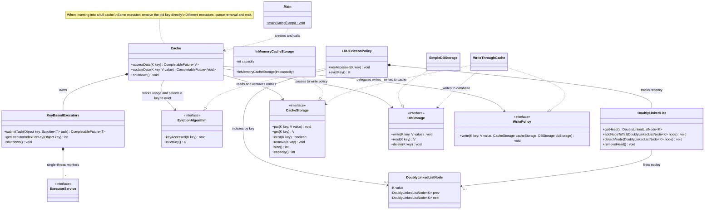

# LRU Cache

## Quick revision

- **When does `updateData` evict?** When the incoming `key` is absent and the cache is full. An existing key can be updated in place. A successful write refreshes the key's recency. [Cache.java](core/Cache.java)
- **How does LRU pick `evictKey`?** A hash map finds each key's list node. The list puts the most recently used key at the tail and picks the least recently used key from the head. [LRUEvictionPolicy.java](evictionpolicy/LRUEvictionPolicy.java)
- **What do the indexes mean?** `currentIndex` is the worker already running the update. `evictedIndex` is the worker assigned to `evictKey`. Each executor has one thread, and the hash of a key determines its worker. [KeyBasedExecutors.java](executors/KeyBasedExecutors.java)
- **Why remove `evictKey`?** `key` is the incoming entry and is still absent. `cacheStorage.remove(evictKey)` removes the existing entry and frees space. [Cache.java](core/Cache.java)
- **What does write-through do?** It writes the value to both cache storage and DB storage and waits for both writes to finish. [WriteThroughCache.java](writepolicy/WriteThroughCache.java)

### The executor decision in `updateData`

With two workers, suppose worker 0 is inserting key `1` into a full cache.

| LRU picks | Decision | Why |
| --- | --- | --- |
| Key `3`, also on worker 0 | Remove `3` directly inside the update job. | Queueing the removal on worker 0 and calling `join()` would deadlock. Worker 0 would wait inside the update, and the queued removal could only start after the update finishes. |
| Key `2`, on worker 1 | Queue the removal on worker 1 and call `join()`. | The removal runs in the same queue as other jobs for key `2`. The update waits for the space to be freed before inserting key `1`. |

## Class diagram

