# Publish–subscribe concurrency

This package implements an in-memory publish–subscribe system. The code uses `Tropic` as the class name for a topic. A topic holds a shared list of messages, and each subscription maintains its own offset into that list.

## Publishing and consuming

1. `KafkaController.createTropic()` allocates a topic ID with an `AtomicInteger`. It registers the topic and its subscriber list in two `ConcurrentHashMap`s. Each topic’s subscriber list is a `CopyOnWriteArrayList`, so a publisher can iterate over a snapshot while subscriptions are added.
2. `KafkaController.subscribe()` creates a `TropicSubscriber` with offset `0` and submits a long-lived `SubscriberController` task to a cached thread pool. Each subscription starts at the beginning of the topic’s retained messages. The same subscriber can have separate offsets and workers on different topics.
3. `SimplePublisher.publish()` calls `KafkaController.publish()` on the calling thread. `Tropic.addMessage()` synchronizes on the topic instance, so concurrent publishers append one at a time to the same topic. After appending, the controller takes each subscription’s monitor and calls `notify()` on it.
4. `SubscriberController.run()` checks whether its offset has reached the end while holding the subscription monitor. If it has, `wait()` releases that monitor so a publisher can acquire it and signal the worker. The worker reacquires the monitor on wakeup, advances the offset with `getAndIncrement()`, and reads the message at the previous offset. It releases the monitor before calling `onMessage()`, so a slow callback leaves the subscription monitor available to publishers.

Each worker calls `onMessage()` sequentially for its own subscription. With no offset reset and successful reads, it follows the topic’s append order. Workers for different subscriptions can run concurrently, so their callbacks and log lines can interleave. The demo shows two subscribers independently consuming `T1` and a third consuming `T2`. It also requests a reset to offset `0` for the first `T1` subscriber to replay earlier messages. [Main.java](Main.java)

## Offset reset and shutdown

`KafkaController.resetOffset()` sets the subscription’s atomic offset, then takes the subscription monitor and signals its worker. A reset affects future reads and can replay messages. A callback already in progress can finish after the reset. The offset records the next read position and advances before the callback runs, even if the callback later fails.

`KafkaController.shutdown()` stops the executor from accepting new tasks and waits up to five seconds. Workers that reach the end of the message list wait for more messages. If the executor is still running after the timeout, `shutdownNow()` requests interruption. The worker exits when `wait()` or `onMessage()` throws `InterruptedException`. Pending deliveries can be left unfinished.

## Concurrency limitations

| Area | Behavior in the current code |
| --- | --- |
| Waiting for messages | The worker uses `if` around `wait()`. A spurious wakeup or a reset that signals a worker with no message available can lead to an out-of-bounds read and end the task. The availability condition needs to be rechecked in a loop after waking. |
| Reading the message list | `Tropic.getMessages()` returns an unmodifiable view of the backing `ArrayList`. The caller’s `size()` and `get()` calls read from that same list after the topic lock is released, while publishers can still append. |
| Resetting the offset | The offset update occurs outside the subscription monitor. It can race with the worker between the availability check and `getAndIncrement()`, even though each offset operation is atomic. An invalid offset can also cause an out-of-bounds read. |
| Registering topics | Topic creation writes to two maps in sequence. If another thread accesses the new ID between those writes, it can see the topic before its subscriber list exists. |
| Thread usage | Each subscription occupies a cached-pool thread for the lifetime of its worker, including time spent waiting for messages. |

## Class diagram

```mermaid
classDiagram
    direction LR

    class Main {
        +main(String[] args)
    }
    class KafkaController {
        +createTropic(String name) Tropic
        +subscribe(String tropicId, ISubscriber subscriber)
        +publish(String tropicId, Message message, IPublisher publisher)
        +resetOffset(String tropicId, ISubscriber subscriber, int newOffset)
        +shutdown()
    }
    class SubscriberController {
        +run()
    }
    class TropicPublisherController {
        +publish(Message message, KafkaController kafkaController)
    }
    class IPublisher {
        <<interface>>
        +getId() String
        +publish(String tropicId, Message message)
    }
    class ISubscriber {
        <<interface>>
        +getId() String
        +onMessage(Message message)
    }
    class SimplePublisher
    class SimpleSubscriber
    class Tropic {
        -String tropicId
        -String tropicName
        +addMessage(Message message)
        +getMessages() List~Message~
    }
    class Message {
        -String message
    }
    class TropicSubscriber {
        -AtomicInteger offSet
    }
    class TropicPublisher

    Main ..> KafkaController : creates
    Main ..> SimplePublisher : creates
    Main ..> SimpleSubscriber : creates
    Main ..> Tropic : uses
    Main ..> Message : creates
    IPublisher <|.. SimplePublisher
    ISubscriber <|.. SimpleSubscriber
    SimplePublisher --> KafkaController : delegates publishing
    KafkaController --> "0..*" Tropic : registers
    KafkaController --> "0..*" TropicSubscriber : tracks
    KafkaController ..> SubscriberController : submits to executor
    SubscriberController --> "1" TropicSubscriber : reads and delivers
    TropicSubscriber --> "1" Tropic : reads from
    TropicSubscriber --> "1" ISubscriber : delivers to
    Tropic --> "0..*" Message : stores
    TropicPublisherController --> "1" TropicPublisher : holds
    TropicPublisherController ..> KafkaController : method parameter
    TropicPublisher --> "1" Tropic : holds
    TropicPublisher --> "1" IPublisher : holds
```

`TropicPublisher` pairs a topic with a publisher. `TropicPublisherController.publish()` is an empty synchronized method. The demo’s publishing path runs directly from `SimplePublisher` to `KafkaController`.
